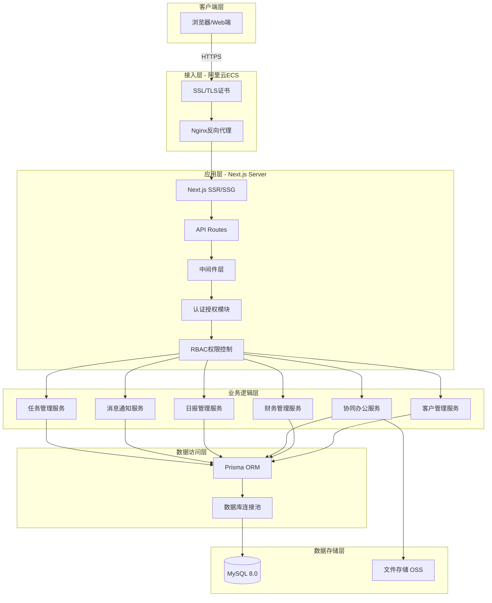

# CRM系统技术架构设计方案

## 项目概述

构建一个基于 Next.js + React + TypeScript 的企业级CRM系统,包含客户管理、财务统计、协同办公三大核心模块,支持4种用户角色(RBAC权限控制),部署于阿里云ECS。

---

## 一、系统架构设计

### 1.1 整体架构图



### 1.2 核心技术栈

**前端技术:**
- Next.js 14 (App Router)
- React 18 + TypeScript 5
- Ant Design 5.x (UI组件库)
- Zustand (状态管理)
- React Query (服务端状态)
- Tiptap (富文本编辑器)
- ECharts (数据可视化)

**后端技术:**
- Next.js API Routes
- Prisma 5.x (ORM)
- NextAuth.js v5 (认证)
- CASL (权限控制)
- Socket.io (实时消息)

**部署运维:**
- 阿里云ECS (2核4GB)
- MySQL 8.0 (RDS推荐)
- Nginx (反向代理)
- PM2 (进程管理)

### 1.3 目录结构

```
crm-system/
├── prisma/                      # Prisma配置
│   ├── schema.prisma           # 数据库模型
│   └── migrations/             # 迁移文件
├── src/
│   ├── app/                    # Next.js App Router
│   │   ├── (auth)/            # 认证路由组
│   │   ├── (dashboard)/       # 主应用路由组
│   │   │   ├── customers/     # 客户管理
│   │   │   ├── finance/       # 财务管理
│   │   │   ├── daily-reports/ # 日报管理
│   │   │   ├── messages/      # 消息中心
│   │   │   ├── tasks/         # 任务管理
│   │   │   ├── files/         # 文件共享
│   │   │   └── admin/         # 管理员后台
│   │   └── api/               # API路由
│   ├── components/            # React组件
│   ├── lib/                   # 工具库
│   ├── services/              # 业务服务层
│   ├── hooks/                 # 自定义Hooks
│   ├── types/                 # TypeScript类型
│   └── stores/                # 状态管理
├── ecosystem.config.js        # PM2配置
└── nginx.conf                 # Nginx配置
```

---

## 二、数据库设计

### 2.1 核心数据表

**用户与权限模块:**
- `users` - 用户表(含username, email, password, realName, department等)
- `roles` - 角色表(admin, sales_manager, sales, finance)
- `user_roles` - 用户角色关联表
- `permissions` - 权限点表(customer:view, order:create等)
- `role_permissions` - 角色权限关联表

**客户管理模块:**
- `customers` - 客户表(基本信息、联系方式、来源、等级、状态)
- `follow_ups` - 跟进记录表(沟通历史、下次联系时间)
- `leads` - 销售线索表(潜在客户、转化跟踪)

**财务管理模块:**
- `orders` - 订单表(合同金额、收款状态、发票信息)
- `payments` - 收款记录表(付款方式、金额、凭证)

**协同办公模块:**
- `daily_reports` - 日报表(富文本内容、审阅状态)
- `messages` - 消息表(内部通讯、系统通知)
- `tasks` - 任务表(任务分配、进度跟踪)
- `files` - 文件表(OSS存储、权限控制)

### 2.2 关键索引策略

- 用户表: username(UK), email(UK), department
- 客户表: salesId, status+level, createdAt, name
- 订单表: orderNo(UK), customerId, salesId, status+createdAt
- 日报表: userId+reportDate(UK), userId, status

---

## 三、API接口设计

### 3.1 认证授权
```
POST   /api/auth/login          # 登录
POST   /api/auth/logout         # 登出
GET    /api/auth/session        # 获取会话
POST   /api/auth/change-password # 修改密码
```

### 3.2 客户管理
```
GET    /api/customers              # 客户列表(分页/筛选/搜索)
POST   /api/customers              # 创建客户
GET    /api/customers/:id          # 客户详情
PUT    /api/customers/:id          # 更新客户
DELETE /api/customers/:id          # 删除客户
POST   /api/customers/:id/follow-ups # 添加跟进记录
GET    /api/customers/:id/follow-ups # 获取跟进记录
```

### 3.3 财务管理
```
GET    /api/finance/orders         # 订单列表
POST   /api/finance/orders         # 创建订单
GET    /api/finance/payments       # 收款记录
POST   /api/finance/payments       # 创建收款
GET    /api/finance/reports/sales-performance  # 业绩报表
GET    /api/finance/reports/receivables        # 应收报表
```

### 3.4 协同办公
```
GET    /api/daily-reports          # 日报列表
POST   /api/daily-reports          # 创建日报
PATCH  /api/daily-reports/:id/review # 审阅日报
GET    /api/messages               # 消息列表
POST   /api/messages               # 发送消息
GET    /api/tasks                  # 任务列表
POST   /api/tasks                  # 创建任务
```

---

## 四、权限设计(RBAC)

### 4.1 角色定义

| 角色 | 权限范围 |
|------|---------|
| **admin** | 所有权限,包括用户管理、系统设置 |
| **sales_manager** | 查看团队客户/订单,审阅下属日报,分配任务 |
| **sales** | 仅操作自己的客户/订单,提交日报 |
| **finance** | 查看所有订单,管理收款,查看财务报表 |

### 4.2 权限拦截策略

- **中间件层**: `/middleware.ts` 路由级权限检查
- **API层**: 每个API端点验证用户权限
- **组件层**: `<PermissionGuard>` 组件级权限控制

---

## 五、阿里云部署方案

### 5.1 服务器配置

**ECS推荐配置:**
- CPU: 2核
- 内存: 4GB
- 系统盘: 100GB ESSD
- 带宽: 5Mbps
- 操作系统: Ubuntu 20.04 LTS
- 成本: ¥300-500/月

### 5.2 数据库配置

**方案A: 阿里云RDS(推荐)**
- MySQL 8.0, 2核4GB, 100GB SSD
- 自动备份,监控告警
- 成本: ¥400-600/月

**方案B: ECS自建**
- 在ECS上安装MySQL 8.0
- 手动配置备份脚本

### 5.3 Nginx配置要点

```nginx
server {
    listen 443 ssl http2;
    server_name crm.yourdomain.com;
    
    # SSL证书
    ssl_certificate /etc/nginx/ssl/your_domain.pem;
    ssl_certificate_key /etc/nginx/ssl/your_domain.key;
    
    # 反向代理到Next.js
    location / {
        proxy_pass http://127.0.0.1:3000;
        proxy_set_header Host $host;
        proxy_set_header X-Real-IP $remote_addr;
    }
    
    # WebSocket支持
    location /socket.io/ {
        proxy_pass http://127.0.0.1:3001;
        proxy_http_version 1.1;
        proxy_set_header Upgrade $http_upgrade;
        proxy_set_header Connection "upgrade";
    }
}
```

### 5.4 PM2配置

```javascript
// ecosystem.config.js
module.exports = {
  apps: [
    {
      name: 'crm-nextjs',
      script: 'node_modules/next/dist/bin/next',
      args: 'start',
      instances: 2,
      exec_mode: 'cluster',
      env: {
        NODE_ENV: 'production',
        PORT: 3000,
      }
    }
  ]
}
```

### 5.5 备份策略

- **数据库备份**: 每天凌晨2点自动备份,保留7天
- **文件备份**: 每周完整备份,上传至阿里云OSS
- **备份脚本**: `/opt/scripts/backup.sh` + crontab定时任务

---

## 六、安全考虑

### 6.1 数据加密
- 密码: bcrypt加密
- 敏感字段(手机号等): AES-256-CBC加密
- HTTPS: SSL/TLS证书强制加密传输

### 6.2 SQL注入防护
- Prisma ORM天然防SQL注入(参数化查询)
- 禁止使用 `$queryRawUnsafe`

### 6.3 XSS防护
- React自动转义输出
- 富文本使用 DOMPurify 清理HTML
- CSP响应头配置

### 6.4 CSRF防护
- NextAuth.js自动处理CSRF令牌
- API请求携带CSRF token验证

### 6.5 数据脱敏
- 手机号: 138****5678
- 邮箱: t***@example.com
- API响应中脱敏敏感信息

---

## 七、开发路线图(12周)

### Phase 1: 基础框架搭建 (2周)
- [ ] 初始化Next.js项目 + TypeScript
- [ ] 配置ESLint + Prettier + Husky
- [ ] 设计数据库Schema (Prisma)
- [ ] 实现用户认证系统 (NextAuth.js)
- [ ] 创建基础布局组件
- [ ] 配置RBAC权限系统 (CASL)
- [ ] 搭建状态管理 (Zustand)

**交付物:** 可运行的基础框架,用户登录功能

### Phase 2: 核心功能开发 (4周)

**Week 3-4: 客户管理**
- [ ] 客户列表(表格/筛选/搜索/分页)
- [ ] 客户详情/创建/编辑
- [ ] 跟进记录管理
- [ ] 销售线索管理
- [ ] 客户导入/导出

**Week 5-6: 财务管理**
- [ ] 订单管理(CRUD)
- [ ] 收款记录管理
- [ ] 业绩报表(按销售/部门/时间)
- [ ] 应收账款统计
- [ ] 数据可视化(ECharts)

**交付物:** 完整的客户管理和财务管理模块

### Phase 3: 高级功能完善 (3周)

**Week 7: 日报系统**
- [ ] 富文本编辑器(Tiptap)
- [ ] 日报创建/提交/审阅
- [ ] 日报统计查询

**Week 8: 消息和任务**
- [ ] 内部消息系统
- [ ] WebSocket实时通知
- [ ] 任务管理(CRUD/分配/跟踪)

**Week 9: 文件共享和其他**
- [ ] 文件上传(阿里云OSS)
- [ ] 文件管理和预览
- [ ] 系统设置
- [ ] 操作日志

**交付物:** 完整的协同办公模块

### Phase 4: 测试和优化 (2周)

**Week 10: 测试**
- [ ] 单元测试(覆盖率>80%)
- [ ] 集成测试(核心API)
- [ ] E2E测试(关键流程)
- [ ] 性能测试
- [ ] 安全测试

**Week 11: 优化**
- [ ] 代码分割和懒加载
- [ ] 数据库查询优化
- [ ] API响应缓存
- [ ] 前端性能优化(Lighthouse>90)
- [ ] 错误监控

**交付物:** 测试报告,性能优化报告

### Phase 5: 部署上线 (1周)

**Week 12:**
- [ ] 阿里云ECS准备
- [ ] MySQL数据库部署
- [ ] 域名和SSL证书配置
- [ ] Nginx反向代理配置
- [ ] PM2进程管理配置
- [ ] 数据库迁移和种子数据
- [ ] 备份策略实施
- [ ] 监控系统配置
- [ ] 编写文档(部署/用户/API)
- [ ] 灰度发布
- [ ] 正式上线

**交付物:** 生产环境运行系统,完整文档

---

## 八、关键技术实现示例

### 8.1 数据库Schema (Prisma)

```prisma
model User {
  id        String   @id @default(uuid())
  username  String   @unique @db.VarChar(50)
  email     String   @unique @db.VarChar(100)
  password  String   @db.VarChar(255)
  realName  String   @db.VarChar(50)
  roles     UserRole[]
  customers Customer[] @relation("SalesCustomer")
  // ...其他字段
}

model Customer {
  id        String   @id @default(uuid())
  name      String   @db.VarChar(100)
  phone     String?  @db.VarChar(20)
  email     String?  @db.VarChar(100)
  level     CustomerLevel @default(POTENTIAL)
  status    CustomerStatus @default(ACTIVE)
  salesId   String
  sales     User     @relation("SalesCustomer", fields: [salesId], references: [id])
  followUps FollowUp[]
  orders    Order[]
  // ...其他字段
}

model Order {
  id            String   @id @default(uuid())
  orderNo       String   @unique @db.VarChar(50)
  contractAmount Decimal @db.Decimal(10, 2)
  paidAmount    Decimal  @default(0) @db.Decimal(10, 2)
  status        OrderStatus @default(PENDING)
  customerId    String
  salesId       String
  customer      Customer @relation(fields: [customerId], references: [id])
  payments      Payment[]
}
```

### 8.2 权限守卫组件

```tsx
// src/components/common/PermissionGuard.tsx
'use client'

import { useSession } from 'next-auth/react'

interface PermissionGuardProps {
  permission: string
  children: ReactNode
  fallback?: ReactNode
}

export default function PermissionGuard({
  permission,
  children,
  fallback = null,
}: PermissionGuardProps) {
  const { data: session } = useSession()
  
  if (!session?.user?.permissions?.includes(permission)) {
    return <>{fallback}</>
  }
  
  return <>{children}</>
}

// 使用示例
<PermissionGuard permission="customer:create">
  <Button onClick={handleCreate}>新建客户</Button>
</PermissionGuard>
```

### 8.3 API路由示例

```typescript
// src/app/api/customers/route.ts
import { auth } from '@/lib/auth'
import { prisma } from '@/lib/prisma'

export async function GET(request: NextRequest) {
  const session = await auth()
  if (!session) {
    return NextResponse.json({ error: 'Unauthorized' }, { status: 401 })
  }
  
  const { searchParams } = new URL(request.url)
  const page = parseInt(searchParams.get('page') || '1')
  const pageSize = parseInt(searchParams.get('pageSize') || '20')
  
  const where: any = {}
  
  // 普通销售只能查看自己的客户
  if (!session.user.roles.includes('admin') && 
      !session.user.roles.includes('sales_manager')) {
    where.salesId = session.user.id
  }
  
  const [customers, total] = await Promise.all([
    prisma.customer.findMany({
      where,
      include: { sales: true },
      skip: (page - 1) * pageSize,
      take: pageSize,
    }),
    prisma.customer.count({ where }),
  ])
  
  return NextResponse.json({
    data: customers,
    pagination: { page, pageSize, total }
  })
}
```

---

## 九、验证与测试

### 9.1 本地开发验证

```bash
# 1. 安装依赖
pnpm install

# 2. 配置环境变量
cp .env.example .env.local
# 编辑 .env.local 填入数据库连接等信息

# 3. 数据库迁移
npx prisma migrate dev

# 4. 种子数据(可选)
npx prisma db seed

# 5. 启动开发服务器
pnpm dev

# 6. 访问 http://localhost:3000
```

### 9.2 生产部署验证

```bash
# 1. 构建项目
pnpm build

# 2. 数据库迁移
npx prisma migrate deploy

# 3. 启动PM2
pm2 start ecosystem.config.js

# 4. 健康检查
curl https://crm.yourdomain.com/api/health

# 5. 查看日志
pm2 logs crm-nextjs

# 6. 监控状态
pm2 monit
```

### 9.3 关键测试场景

1. **权限测试**: 用不同角色账号登录,验证菜单和按钮显示
2. **数据隔离**: 销售A不能看到销售B的客户
3. **日报流程**: 销售提交 → 主管审阅 → 状态变更
4. **财务统计**: 订单创建 → 收款记录 → 报表数据一致性
5. **并发测试**: 多用户同时操作,验证数据完整性

---

## 十、成本估算

### 开发成本
- 前端开发: 2人 × 3个月 = ¥30-40万
- 后端开发: 1人 × 3个月 = ¥15-20万
- UI设计: 1人(兼职) = ¥3-5万
- 测试: 1人(兼职) = ¥2-3万
- **合计:** ¥50-68万

### 运维成本(首年)
- 阿里云ECS: ¥300-500/月 × 12 = ¥3600-6000
- 阿里云RDS: ¥400-600/月 × 12 = ¥4800-7200
- 域名+SSL: ¥100-300/年
- **合计:** ¥8500-13500/年

### 总成本(首年)
**¥51-69万**

---

## 十一、风险与应对

| 风险 | 影响 | 应对措施 |
|------|------|---------|
| 需求变更 | 延期 | 采用敏捷开发,分阶段交付 |
| 性能瓶颈 | 用户体验差 | 前期做好压力测试,预留优化空间 |
| 安全问题 | 数据泄露 | 严格的安全测试,定期漏洞扫描 |
| 人员流动 | 知识断层 | 完善文档,代码审查制度 |
| 技术债务 | 维护困难 | 持续重构,保持代码质量 |

---

## 十二、后续扩展建议

1. **移动端**: React Native开发iOS/Android App
2. **AI集成**: 智能客户推荐,销售预测
3. **BI分析**: 更强大的数据分析看板
4. **微服务**: 大模块拆分为独立服务
5. **国际化**: 多语言支持
6. **第三方集成**: 企业微信,钉钉,ERP系统

---

## 总结

本方案提供了一个**完整、可执行、企业级**的CRM系统架构设计:

✅ **技术先进**: Next.js 14 + React 18 + TypeScript  
✅ **安全可靠**: RBAC权限,多层安全防护  
✅ **性能优异**: 数据库优化,缓存策略  
✅ **易于扩展**: 模块化设计,清晰架构  
✅ **部署简单**: 阿里云一键部署方案  
✅ **成本可控**: 适合中小型团队  

**开发周期:** 12周(3个月)  
**团队配置:** 前端2人 + 后端1人 + UI 1人(兼职) + 测试1人(兼职)  
**首年总成本:** ¥51-69万

建议采用**敏捷开发**模式,每2周一个迭代,快速交付可用版本,持续优化完善。
