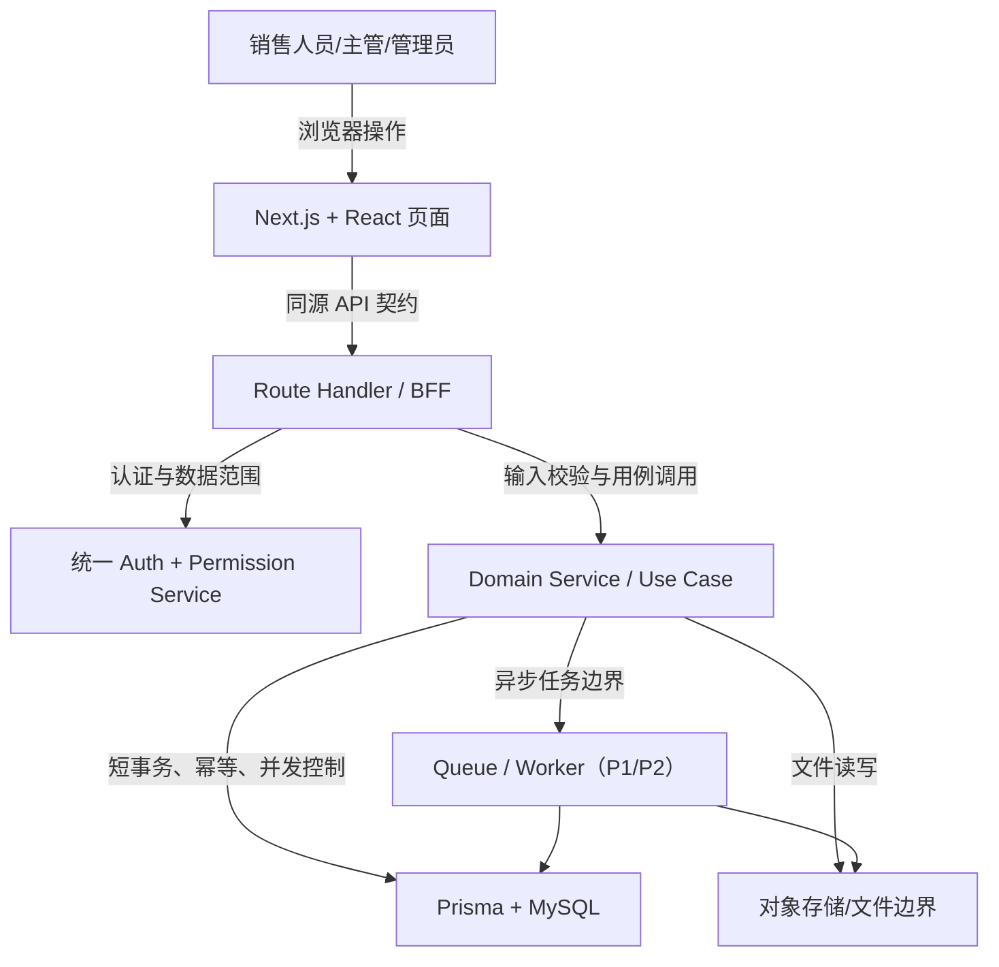

# Design: crm-market-requirements-enhancement

## Architecture

本轮不迁移主语言，目标是把现有 Next.js 全栈代码整理为可继续演进的模块化单体。页面仍由 Next.js/React 提供；认证、数据范围和业务用例集中在服务层；Prisma 是数据库访问边界；外部对象存储、未来队列和连接器保持显式边界。

## Interfaces

本轮不定义新的外部 API 结构，只确定后续接口设计必须保持的不变量：

- 先为 34 个现有 Route Handler 建立方法、路径、请求字段、响应 JSON、HTTP 状态码、错误文本/错误码和前端调用方快照，再决定哪些结构需要标准化。
- 标准化过程默认保持旧消费者兼容；如需改变响应包络、分页、错误码、幂等或并发字段，必须在独立接口设计变更中给出版本策略、双写/适配期和逐路由回归测试。
- 服务端会话是用户身份、角色和权限的可信来源；客户端提交的 `userId/roles/permissions` 不作为授权依据。
- 列表、详情、写入、删除、导出和报表下钻必须共用同一套功能权限与数据范围规则，不返回未授权记录。
- 金额保持 Decimal 语义；重试写操作不得产生重复收款、重复领取或重复归属转移；竞争更新不得静默覆盖。

## Data Model

- 保留现有 `User`、`Role`、`Permission`、`Customer`、`Lead`、`FollowUp`、`Order`、`Payment`、`DailyReport`、`Task`、`Message`、`File`、`ContractArchive` 等实体；不在本轮新增 `tenantId/orgId`。
- 为需要竞争更新的实体增加单调 `version` 或等价并发令牌；业务唯一键由数据库唯一约束保障，不能只依赖应用层查重。
- 新增审计记录形状：`id`、`actorId`、`action`、`resourceType`、`resourceId`、`beforeJson`、`afterJson`、`requestId`、`createdAt`；敏感字段按字段策略脱敏。
- 新增自动化规则形状：`id`、`name`、`enabled`、`version`、`trigger`、`conditionsJson`、`actionsJson`、`retryPolicyJson`、`createdBy`、`updatedAt`；执行日志记录规则版本、输入摘要、结果、错误和重试次数。
- 金额字段继续使用 Prisma `Decimal` 与 MySQL 定点数；API DTO 使用字符串或明确的 Decimal 序列化策略，前端展示层再转为数字。
- 文件实体保存对象键、媒体类型、大小、哈希、归属资源和访问策略；下载通过服务端鉴权后生成短期签名 URL。

## Key Decisions

### 继续 TypeScript 单体，而不是立即跨语言重写
- Problem: 当前 34 个 API 文件把认证、CASL、JSON 解析和 Prisma 查询写在同一层；如果现在换 Java/.NET/Python/Go，页面可保留，但认证、权限、16 个模型、19 个枚举、迁移、文件和契约测试都要重建，现有缺陷会在重写中被重新解释。
- Solution: 继续采用 TypeScript/Next.js/React 技术族，在同一工程内建立 Service/Use Case、DTO/Zod、统一授权和事务边界；Next.js 15.4/React 19 作为独立兼容升级目标，实施顺序由回归风险评估决定。
- Cost: 继续承担 Node 运行时与 Next.js BFF 的边界治理，需要补队列、共享缓存和独立 API 的运维能力。
- Why not alternatives: Java/.NET 的企业后端能力强但重写成本高；Python 适合 AI/后台服务但不是当前团队约束的自然解；Go 适合外围高并发服务而非 CRM 主领域；立即拆分会增加双栈维护而不解决当前业务缺陷。

### 以触发条件决定何时拆后端
- Problem: 仅凭“未来可能多租户或高并发”提前拆分，会在没有稳定契约和服务边界时引入认证、文件、部署和数据一致性问题。
- Solution: 监管或客户合同要求独立安全边界、网络隔离、统一企业 SSO 时立即评估；其余扩容、队列、多客户端、团队平台和规模信号综合判断。触发后按团队、运维、合规和实测负载比较候选 PoC，不固定语言顺序。
- Cost: 需要先投入契约测试、审计和服务层整理；短期看不到“换语言”的表面收益。
- Why not alternatives: 立即重写的收益依赖尚未出现的规模条件；完全不设触发条件又会让架构演进失去可观察门槛。

## Migration / Compatibility

- 先生成现有 `/api/*` 的逐路由契约快照和前端调用清单，再迁移服务层；任何响应标准化都通过兼容适配或版本化接口实施。
- 原 Prisma schema 和已有 MySQL 数据保留；后续 schema 变更采用 expand/contract、备份与回滚演练，并为金额、枚举、Json、唯一约束和级联关系增加回归测试。
- 旧 NextAuth session 字段在本轮保持 `session.user.id/roles/permissions` 兼容；Next.js 15.4/React 19 升级必须覆盖 JWT callback、登录态续期、受保护页面/API、列表/详情/导出/报表下钻的数据范围矩阵。
- 文件迁移前记录本地路径、对象键、下载 URL 和权限行为；后续切换共享卷或对象存储时验证旧对象可读、未授权下载被拒绝、签名 URL 有效期和回滚路径。
- 若未来拆为独立后端，先生成 OpenAPI/契约测试，再按资源迁移；React/Ant Design 页面、对象存储键和数据库表结构优先复用。
- 旧版 DOCX 与旧生成入口不替换；市场调研完善版另行生成，业务源码不在本轮修改。
