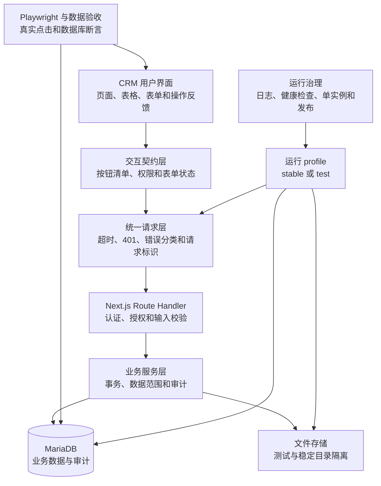

# Design: crm-comprehensive-quality-optimization

## Architecture

stable 和 test 共享代码，不共享可写数据库、上传目录、端口、PID/锁和日志文件。页面只能通过统一请求层访问 Route Handler；按钮清单作为 UI、权限、接口和验收之间的共同契约。

## Interfaces

- `apiRequest<T>(input, init, options)`：浏览器统一请求接口
  - Input: URL、标准 `RequestInit`、`{ timeoutMs, retryPolicy, requestKey, preserveDraft }`。
  - Output: `Promise<T>`；成功返回经过类型校验的数据，失败抛出结构化 `ApiError`。
  - Error codes: `UNAUTHORIZED`、`FORBIDDEN`、`VALIDATION_ERROR`、`CONFLICT`、`TIMEOUT`、`OFFLINE`、`SERVER_ERROR`。
  - Invariants: 非幂等写操作不自动重试；每个请求携带或接收 `requestId`；401 只能进入明确的重新认证流程。
- `ButtonContract`：按钮级验收清单
  - Fields: `id`、`route`、`label`、`requiredPermission`、`handler`、`method`、`endpoint`、`successEvidence`、`databaseEvidence`、`auditEvidence`、`failureEvidence`、`status`。
  - Invariants: `status=active` 时 handler、接口和验收证据均不可为空；没有真实动作的控件不得标为 active。
- `GET /api/health`：运行状态检查
  - Input: 无；深度检查通过受保护参数或独立内部入口触发。
  - Output: `{ status, profile, version, uptime, database, timestamp }`，不返回连接串、密钥或用户数据。
  - Error codes: `503` 表示关键依赖不可用。
  - Invariants: test/stable profile 可识别；健康检查不修改数据库。
- 文件能力：`GET/POST /api/files`、`GET/DELETE /api/files/:id`
  - Input: 分页筛选、文件元数据或文件 ID；上传受大小、类型和权限限制。
  - Output: 真实文件列表、上传结果、下载响应或删除结果。
  - Error codes: `UNAUTHORIZED`、`FORBIDDEN`、`NOT_FOUND`、`FILE_TOO_LARGE`、`UNSUPPORTED_TYPE`、`STORAGE_ERROR`。
  - Invariants: 数据库元数据与存储对象一致；下载和删除受数据范围控制并记录审计。
- 消息能力：`GET /api/messages`、`PATCH /api/messages/:id/read`、`POST /api/messages/read-all`、`DELETE /api/messages/:id`
  - Input: 分页、状态筛选或消息 ID。
  - Output: 当前用户消息、未读数和操作结果。
  - Error codes: `UNAUTHORIZED`、`FORBIDDEN`、`NOT_FOUND`。
  - Invariants: 用户只能访问自己的收件消息；已读和删除结果必须持久化。
- 用户与角色管理：在现有 `/api/users`、`/api/roles` 基础上补齐读取、创建、更新、停用和角色分配契约
  - Input: 强类型用户、角色和权限字段。
  - Output: 脱敏用户信息及操作结果。
  - Error codes: `UNAUTHORIZED`、`FORBIDDEN`、`VALIDATION_ERROR`、`CONFLICT`、`NOT_FOUND`。
  - Invariants: 不返回密码哈希；最后一个有效管理员不得被误停用；按钮权限与 API 权限一致。
- 系统设置：`GET/PUT /api/settings`
  - Input: 现有 `systemName`、`companyName` 字段及后续经批准的设置字段。
  - Output: 当前设置与更新结果。
  - Error codes: `UNAUTHORIZED`、`FORBIDDEN`、`VALIDATION_ERROR`。
  - Invariants: 仅允许明确白名单字段；更新记录操作者、时间、前后摘要和 `requestId`。
- `python scripts\manage.py <action> --profile <stable|test>` 与 `scripts/manage.sh`
  - Actions: `check`、`start`、`stop`、`status`、`button-audit`、`data-reachability`、`e2e`、`perf`、`release`、`promote`、`rollback`。
  - Output: 明确退出码、终端摘要和 `logs/<profile>/` 文件日志。
  - Invariants: profile 必须显式解析；涉及迁移、提升或回滚的动作先检查备份、目标数据库和单实例状态。

## Data Model

- 现有 `Customer`、`Lead`、`TelemarketingList`、`FollowUp`、`Order`、`Payment`、`DailyReport`、`Message`、`Task`、`File`、`ContractArchive`、`User`、`Role`、`Permission` 和 `AuditEvent` 继续作为业务数据来源，不删除既有字段。
- 文件和消息页面改用现有 `File`、`Message` 模型；用户管理改用现有用户、角色、权限关联，不再读取页面内 mock 数组。
- 若现有 schema 无法持久化 `systemName` 和 `companyName`，新增最小 `SystemSetting` 结构：`key` 唯一、`value`、`updatedBy`、`createdAt`、`updatedAt`；不得把密码、连接串和密钥存入该表。
- 按钮清单与性能基线属于版本化测试资产，不写入生产业务表；测试夹具写入独立 test 数据库并带统一前缀和清理标识。
- 对高频列表和筛选在实测慢查询后补充索引；没有查询证据时不预先堆叠索引。

## Key Decisions

### 1. 测试版与稳定版做数据级隔离

- Problem: 如果测试版与稳定版共用数据库或上传目录，按钮 E2E、迁移和性能测试可能改写真实客户、订单和文件。
- Solution: 两个 profile 使用独立连接、目录、端口、PID/锁和日志，发布提升只提升构建与配置模板，不复制测试数据覆盖稳定数据。
- Cost: 增加环境配置、存储和发布脚本维护；需要分别管理密钥和备份。
- Why not the alternatives: 只用不同端口不能隔离数据；用字段标记测试数据仍可能被统计和权限查询误读；不隔离无法自动执行写入验收。

### 2. 框架升级先进入 test，不与稳定版质量修复绑定发布

- Problem: Next.js 14/React 18 到 Next.js 15.4/React 19 会影响认证、中间件、Ant Design 和构建，直接上线会把功能修复与框架回归混在一起。
- Solution: 在 test profile 完成依赖升级、ESM 配置、类型检查、构建和完整按钮 E2E；只有全部通过并完成回滚演练才允许提升 stable。
- Cost: 一段时间内需要维护升级分支或明确的可回退提交，发布周期更长。
- Why not the alternatives: 稳定版直接升级风险过大；长期停留旧栈违反当前项目约束；同时引入新 UI 框架会扩大无关变更。

## Migration / Compatibility

- 所有数据库迁移先对 test 数据库执行并验证备份恢复，再安排 stable；不得删除原始字段或覆盖稳定版数据。
- 页面 URL、现有销售字段和主要业务名称保持不变；大页面拆分只改变内部结构，不改变用户入口。
- 请求层按页面逐步接入；接入页面不得保留旧请求失败后静默改走旧逻辑的路径。
- mock 页面切换到真实接口时，现有可见字段全部保留；无法真实实现的按钮在同一变更内移除或明确禁用，并在按钮清单记录原因。
- 框架升级保留升级前可构建提交和稳定版产物；promotion 失败时按提交与发布清单回滚，不进行运行时静默降级。

