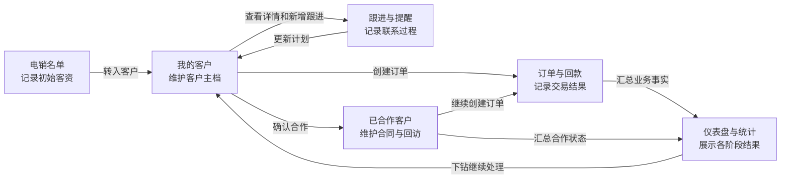

# Design: crm-sales-sop-completion

## Architecture

这条链路以现有 `Customer` 为客户事实源，跟进、订单、回款和合同备案继续使用各自现有表。页面操作只改变已有数据，不新增商机、报价或审批概念。

发布链路单独形成验证回路：本地候选包通过 SOP E2E 后上传到临时目录，在备用端口启动并检查健康；切换正式服务后核对提交、静态资源、Nginx 活跃日志和关键浏览器动作，失败则恢复上一稳定包。

## Interfaces

- `GET /api/customers/[id]`
  - Input: 路径参数 `id: UUID`。
  - Output: `{ success: true, data: CustomerDetail }`；`CustomerDetail` 包含客户主档、销售负责人、最近 10 条完整跟进、最近 5 条订单和现有线索摘要。
  - Error codes: `401 UNAUTHORIZED`、`403 FORBIDDEN`、`404 CUSTOMER_NOT_FOUND`、`500 SERVER_ERROR`。
  - Invariants: 必须执行客户数据范围校验；列表摘要不能冒充详情；失败响应带 `requestId`。

- `POST /api/customers/cooperating`
  - Input: `{ customerId: UUID, contractEndDate: ISO date, contractStartDate?: ISO date, contractAmount?: number }`。
  - Output: `{ success: true, data: Customer, message: string }`，返回客户状态为 `COOPERATING`。
  - Error codes: `400 VALIDATION_ERROR`、`401 UNAUTHORIZED`、`403 FORBIDDEN`、`404 CUSTOMER_NOT_FOUND`、`409 ALREADY_COOPERATING`、`500 SERVER_ERROR`。
  - Invariants: 到期日期必填；开始日期不得晚于到期日期；同一请求重复提交不得产生重复审计；状态变更与审计在同一事务内完成。

- `GET /api/customers?orderEligible=true&page=<n>&pageSize=<n>&keyword=<text>`
  - Input: `orderEligible` 为可选布尔查询参数；其他参数沿用现有分页和搜索规则。
  - Output: 沿用客户列表响应；启用时只返回当前用户数据范围内、非公海且状态属于 `ACTIVE | COOPERATING` 的客户。
  - Error codes: 沿用客户列表接口错误，非法布尔值返回 `400 VALIDATION_ERROR`。
  - Invariants: 订单候选资格由服务端定义，前端不能通过拼接任意状态绕过；现有不带该参数的列表行为保持不变。

- `POST /api/finance/orders`
  - Input: 沿用现有订单创建结构和 `x-request-id`。
  - Output: 沿用现有订单创建响应和重复请求回放标识。
  - Error codes: 保留现有校验，并将不可建单客户统一为可理解的中文业务错误。
  - Invariants: 仅 `ACTIVE | COOPERATING`、非公海、当前用户可访问的客户可建单；订单销售负责人继续取客户负责人；写操作不自动重试。

- 仪表盘统计区域状态合同
  - Input: 各组件继续调用 `/api/statistics/sales-overview`、`/api/statistics/trend`、`/api/statistics/funnel`、`/api/reminders`。
  - Output: 每个区域具有 `loading | success | empty | error` 四种可见状态，错误状态显示简短说明和“重新加载”操作。
  - Error codes: 沿用对应接口；组件保留最近一次成功数据，重试失败时不得清空其他区域。
  - Invariants: 单个接口失败不卸载整页或相邻区域；保留旧数据时必须显示上次更新时间和“数据可能已过期”；网络恢复后只重新读取，不重放写请求。

- `python scripts\manage.py sop-flow --profile test`
  - Input: test profile、独立测试数据库、测试账号和可选保留失败证据开关。
  - Output: 电销转客户、完整详情、跟进、转已合作、合作客户建单、回款、提醒和统计的一次串行验收报告；失败返回非零退出码，日志写入 `logs/test/`。
  - Error codes: 环境隔离、服务启动、浏览器动作、接口、数据库、审计或清理任一失败均返回非零退出码。
  - Invariants: 不连接 stable 数据库；成功和失败均清理测试业务数据、上传物、会话和临时进程。

- 生产发布后验证
  - Input: 目标主机、稳定包、预期完整提交、上一稳定包；敏感配置只从环境读取。
  - Output: 备份、备用端口健康、正式切换、提交一致性、静态资源、Nginx 配置/日志、登录和 SOP 冒烟结果。
  - Error codes: 任一门禁失败停止切换；切换后失败则恢复上一稳定包并保留日志。
  - Invariants: 不删除原始业务数据；先备份线上实际 Nginx 配置，只合并代理、日志和版本标识，保留现有 TLS/Certbot 配置；`nginx -t` 通过后才 reload；线上受控写入只使用可识别并可清理的验收记录。

## Data Model

- 不新增 Prisma 模型、字段或枚举值，不执行数据迁移。
- `Customer.status` 本轮使用的业务语义：
  - `ACTIVE`：已归属销售、尚未进入合作维护，可跟进、转已合作、建单。
  - `COOPERATING`：已经确认合作，可继续跟进、回访、合同备案、建单和回款。
  - `INACTIVE`：软删除或进入公海后的不可操作状态；认领后恢复 `ACTIVE`。
  - `FOLLOWING`、`CONVERTED`、`LOST`：保留现有兼容值，本轮不新增页面写入路径，也不改写历史数据。
- 销售漏斗以现有业务事实计算，不依赖手工维护中间状态：客户归属、是否跟进、是否确认合作、是否有订单、是否有回款分别从 `Customer`、`FollowUp`、`Order` 和 `Payment` 得出。
- 审计继续使用 `AuditEvent`，至少覆盖电销转客户、客户跟进、转已合作、建单和回款；所有失败写入不得产生成功审计。

## Key Decisions

### 1. 已合作客户仍可建单

- Problem: 销售把客户转为已合作后，订单页面不再显示该客户，接口也拒绝创建订单，流程在成交后反而中断。
- Solution: 把订单资格定义为“已归属、非公海、状态为活跃或已合作”，前端候选和服务端校验共享同一规则。
- Cost: 订单候选数量增加，需要用权限和数据范围测试防止跨销售选择。
- Why not the alternatives: 强制先建单再转合作会限制实际录入顺序；继续只允许活跃客户会保留已确认的阻塞；新增商机状态超出当前字段范围。

### 2. 发布验证必须证明浏览器使用的是目标提交

- Problem: 当前健康接口正常，但线上仍运行旧提交，业务按钮缺失；同时 Nginx 日志写入旧目录，故障时无法得到完整证据。
- Solution: 候选包先在备用端口验证，切换后同时比对健康提交、页面资源和关键操作，并重新打开 Nginx 日志文件。
- Cost: 发布时间增加，需要维护上一稳定包和一次短暂切换窗口。
- Why not the alternatives: 只重启进程不能证明目录和静态资源正确；只看 HTTP 200 会再次漏掉旧版本；直接覆盖现网后再排错会扩大影响。

## Migration / Compatibility

- 数据库 schema 不变，现有客户、跟进、订单、回款、合同和审计数据原样保留。
- 客户列表默认查询行为不变，仅 `orderEligible=true` 启用新增筛选语义；现有调用者不受影响。
- `POST /api/customers/cooperating` 收紧为到期日期必填，与当前可见表单一致；旧代码若直接调用且不传日期将收到明确 `400`。
- 仪表盘接口路径和成功响应不变，仅前端增加失败状态；可以按组件独立回退。
- 部署失败时恢复上一稳定应用包和 Nginx 配置，数据库不自动回退或删除业务记录。
