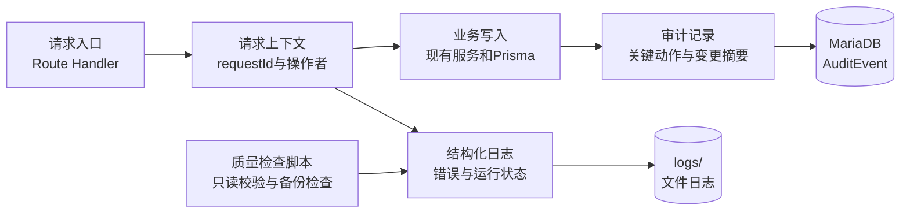

# Design: crm-sales-sop-completion

## Architecture

页面和现有业务入口保持不变。治理层只负责记录上下文、过滤敏感数据、写入审计和输出可定位错误，不自行改变客户、订单、回款和合同的业务状态。

## Interfaces

- `recordAuditEvent(db, input)`：服务端内部接口
  - Input: `Prisma.TransactionClient | PrismaClient` 与 `{ actorId?: string, action: string, entityType: string, entityId?: string, beforeData?: unknown, afterData?: unknown, reason?: string, requestId?: string }`。
  - Output: `Promise<void>`；审计写入失败直接抛出异常。
  - Error codes: `AUDIT_WRITE_FAILED`。
  - Invariants: 密码、令牌、Cookie、连接串、密钥、签名 URL 和字段名匹配的敏感值不得写入 `before`、`after` 或 `reason`。
- `getRequestId(request)`：服务端内部接口
  - Input: Web `Request`，允许透传长度不超过 100 的 `x-request-id`，否则生成随机标识。
  - Output: `string`。
  - Error codes: 无；请求标识生成失败应抛出异常。
  - Invariants: 同一个请求的响应、日志和审计事件使用同一 `requestId`。
- `GET /api/audit-events`：Phase 1 只提供管理员查询基础
  - Input: 分页、`entityType`、`entityId`、`action`、`actorId`、开始/结束时间。
  - Output: `{ success: true, data: { list, total, page, pageSize } }`，事件中的敏感字段已经过滤。
  - Error codes: `UNAUTHORIZED`、`FORBIDDEN`、`VALIDATION_ERROR`。
  - Invariants: 仅管理员或明确拥有审计查看权限的用户可查询；默认不返回密码、令牌和完整文件凭据。
- `python scripts\manage.py audit-data`：本地和部署检查入口
  - Input: 环境变量 `DATABASE_URL` 和可选备份路径。
  - Output: 检查报告、退出码和 `logs/` 日志。
  - Error codes: 非零退出码表示检查失败或无法验证。
  - Invariants: 默认只读，不创建、修改或删除业务数据。

## Data Model

- `AuditEvent`：`id`、`actorId`、`action`、`entityType`、`entityId`、`beforeData`、`afterData`、`reason`、`requestId`、`createdAt`。
- `actorId` 关联 `User`，用户删除时保留审计事件并将操作者置空；业务对象删除不级联删除审计事件。
- `beforeData`、`afterData` 使用 JSON 存储经过过滤的摘要，不保存整个数据库对象，不保存密码、令牌、Cookie、连接串和签名凭据。
- 对 `entityType + entityId + createdAt`、`actorId + createdAt`、`action + createdAt` 建立索引，支持管理员按对象和时间查询。
- 不修改现有 `Customer`、`Order`、`Payment`、`ContractArchive` 和 `FollowUp` 字段含义；公海 JSON 历史继续保留。

## Key Decisions

### 1. 独立审计表，不把审计继续堆在业务 JSON 中

- Problem: 公海历史只能覆盖部分客户动作，无法统一查询订单、回款、合同、下载和权限变化。
- Solution: 用独立结构化事件表保存关键操作摘要，业务表继续保存自身状态和兼容字段。
- Cost: 增加迁移、写入和存储；审计字段需要长期维护和脱敏测试。
- Why not alternatives: 继续使用 JSON 无法统一检索；只写文件日志难以按业务对象查询；不记录则无法满足追溯要求。

### 2. 治理层先做关键路径，不全量重写 37 个接口

- Problem: 全量重写会同时改变接口响应、权限和页面行为，当前没有足够真实业务数据进行回归。
- Solution: Phase 1 先覆盖高风险写入和下载路径，再按验收结果扩展到其他入口。
- Cost: 第一阶段审计覆盖不是所有接口，需求文档必须标明已覆盖和未覆盖清单。
- Why not alternatives: 全量接入成本和回归风险过高；完全不接入则无法验证治理目标。

## Migration / Compatibility

- 新增表使用独立 Prisma migration；上线前先备份、检查迁移状态并执行恢复点确认。
- `actorId` 可空，保证停用或历史用户不存在时仍能保留事件。
- 旧业务接口继续使用原路径和原响应；治理失败时按提案规则拒绝宣称关键写入成功，不静默绕过审计。
- 审计查询先作为管理员内部入口，不改变现有销售页面菜单；确认权限和数据范围后再决定是否开放页面入口。
